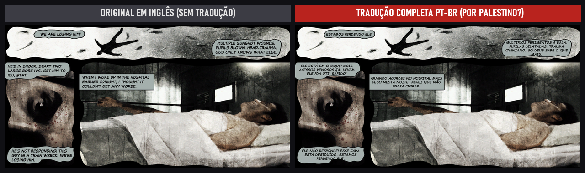
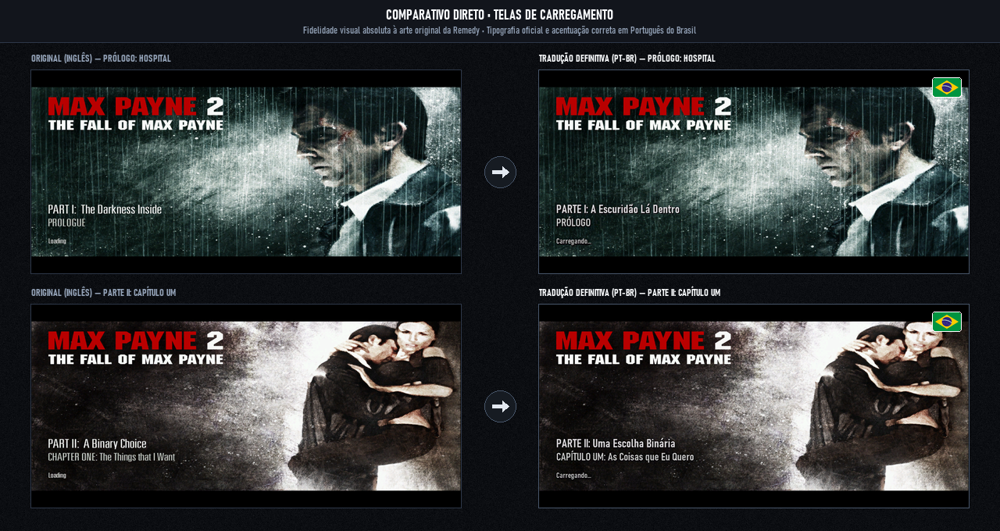
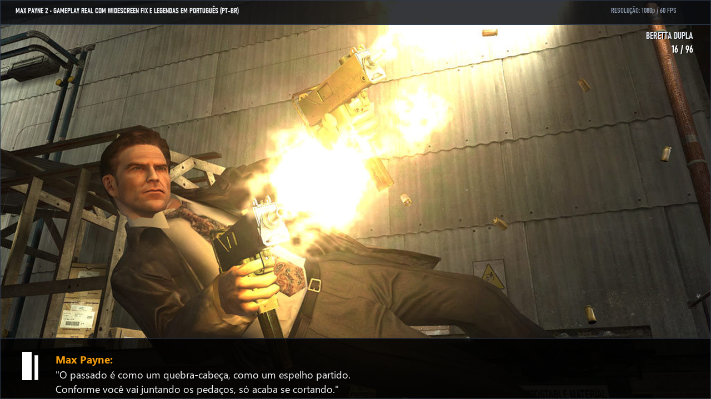

# 🇧🇷 Max Payne 2 — Tradução Definitiva PT-BR (v3.0.0)

**A tradução mais completa e definitiva de *Max Payne 2: The Fall of Max Payne* para Português do Brasil. Inclui 138 páginas de Graphic Novels traduzidas diretamente nos quadrinhos, 32 telas de carregamento e menus, vídeo de introdução legendado, HUD de armas em alta definição e instalador 100% seguro.**

*Desenvolvido e revisado por **[palestino7](https://github.com/palestino7)***

 

### ⬇️ [BAIXAR INSTALADOR (v3.0.0) — `Instalador_MaxPayne2_PTBR_v3.0.0.exe`](https://github.com/palestino7/max-payne-2-traducao-ptbr/releases/download/v3.0.0/Instalador_MaxPayne2_PTBR_v3.0.0.exe)
*(Ou acesse a aba [**Releases**](https://github.com/palestino7/max-payne-2-traducao-ptbr/releases) para pacotes avulsos)*

---

## ⚡ Instalação Rápida

1. Baixe o [`Instalador_MaxPayne2_PTBR_v3.0.0.exe`](https://github.com/palestino7/max-payne-2-traducao-ptbr/releases/download/v3.0.0/Instalador_MaxPayne2_PTBR_v3.0.0.exe).
2. Execute o instalador (a pasta do jogo na Steam, GOG ou CD é detectada automaticamente).
3. Clique em **Instalar** e inicie o jogo normalmente!

> [!TIP]
> **Backup Automático:** O instalador preserva seus arquivos originais. A desinstalação é 100% limpa e reversível em 1 clique.

---

## 🎨 Demonstração Visual

### Graphic Novels 100% Traduzidas nos Balões
Todas as 138 páginas de quadrinhos foram traduzidas diretamente sobre a arte original de Ashley Wood, sem perdas ou borrões:

### Telas de Carregamento em Português
Todos os capítulos da história e o modo *Homem Morto Caminhando* trazem telas de carregamento com tipografia e acentuação oficiais:

### Legendas de Gameplay, Menus e HUD de Armas
Diálogos, transmissões de rádio, menus de ajuda e seletores de armas totalmente traduzidos:

---

## 🛡️ Destaques da Versão 3.0.0

- **Instalador Seguro:** Construído em Inno Setup nativo, livre de falsos-positivos no Windows Defender e Chrome.
- **Vídeo de Introdução Legendado:** Cutscene cinematográfica "Anteriormente..." com áudio original e legendas perfeitamente sincronizadas.
- **Correção de Áudio:** Patch de engine (`sndmfc.dll`) para manter legendas ativas em qualquer volume.
- **Widescreen Fix:** Suporte automático a resoluções modernas (Full HD/4K) e controles Xbox.

---

## 🔒 Checksums de Integridade (SHA-256)

Consulte o arquivo oficial [`SHA256SUMS.txt`](https://github.com/palestino7/max-payne-2-traducao-ptbr/releases) para validação dos executáveis e pacotes da release.

---

## ❓ Perguntas Frequentes (FAQ)

<b>Funciona na Steam e GOG no Windows 10 e 11?</b>

 
Sim! Compatível com todas as edições de PC, corrigindo travamentos de monitores modernos e Alt+Tab.

<b>Como ativar as legendas no jogo?</b>

 
No menu principal, acesse <b>Opções → Jogo → Legendas: Ligadas</b> (ou aperte <b>T</b> durante o jogo).

---

## 👤 Créditos

- **Tradução, Edição Gráfica e Instalador:** [**palestino7**](https://github.com/palestino7)
- **Widescreen Fix:** ThirteenAG e samuelgr.
- **Max Payne 2: The Fall of Max Payne** © Remedy Entertainment & Rockstar Games. Projeto sem fins lucrativos feito de fã para fãs.
