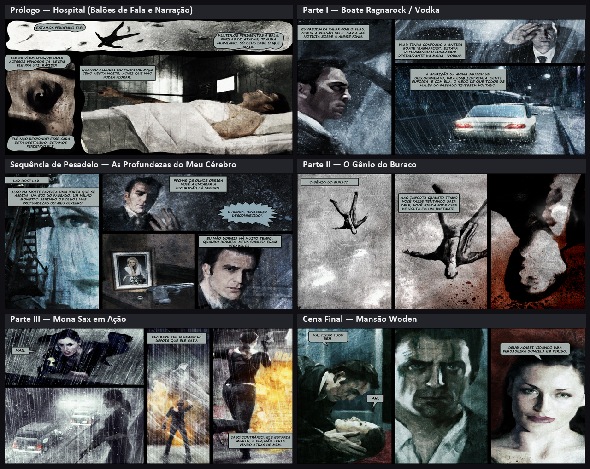
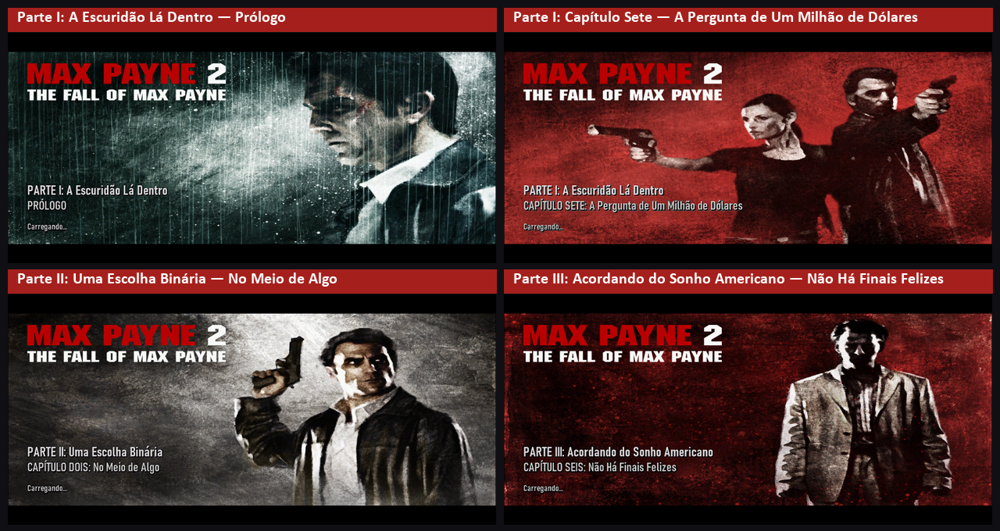
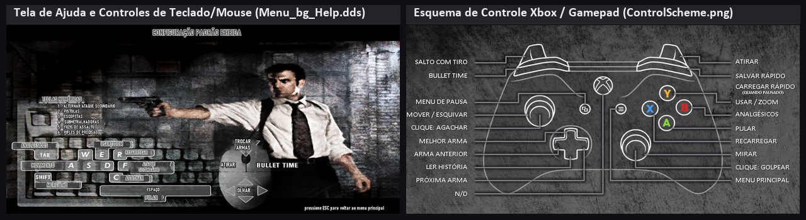
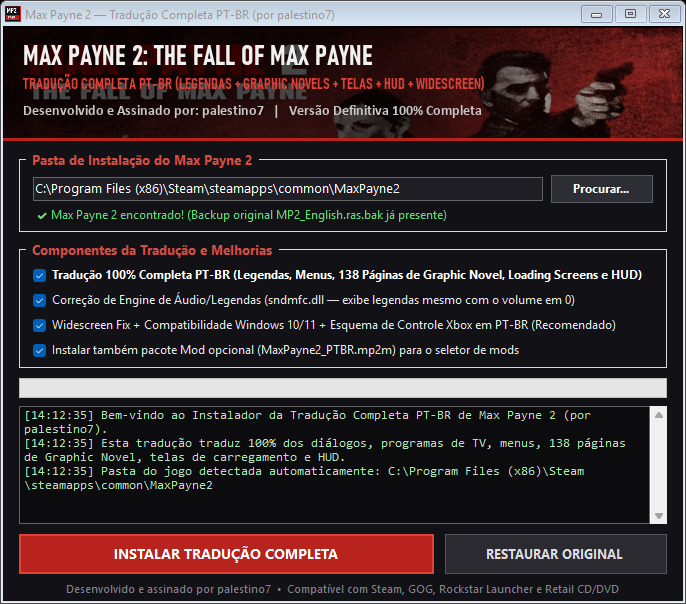

<div align="center">


# 🇧🇷 Max Payne 2: The Fall of Max Payne — Tradução 100% Completa PT-BR (Versão Definitiva)

**A MELHOR, mais fiel e única tradução realmente 100% completa de *Max Payne 2: The Fall of Max Payne* para Português do Brasil (PT-BR) — incluindo todas as 138 páginas de Graphic Novel traduzidas diretamente nos balões, telas de carregamento, HUD, programas de TV, Widescreen Fix e correções de engine.**

*Desenvolvido, revisado e assinado digitalmente por **[palestino7](https://github.com/palestino7)***

[](https://github.com/palestino7/max-payne-2-traducao-ptbr/releases)
[%20100%25-2ea44f?style=for-the-badge)](#)
[](#-graphic-novels-100-traduzidas-nos-balões-exclusivo)
[](#-tutorial-de-instalação-passo-a-passo)
[](https://github.com/palestino7)

<br>

### ⬇️ [BAIXAR INSTALADOR AUTOMÁTICO (.EXE) — `Instalador_Traducao_MaxPayne2_PTBR_palestino7.exe`](https://github.com/palestino7/max-payne-2-traducao-ptbr/raw/main/Instalador_Traducao_MaxPayne2_PTBR_palestino7.exe)
*(Ou acesse a aba [**Releases**](https://github.com/palestino7/max-payne-2-traducao-ptbr/releases) para baixar o instalador `.exe` ou o pacote `.mp2m` avulso)*

</div>

---

## 🏆 Por que esta é a MELHOR Tradução de Max Payne 2 para PT-BR?

Durante anos, quem tentou jogar *Max Payne 2: The Fall of Max Payne* em português esbarrou nas limitações das traduções antigas feitas nos anos 2000 (como os patches antigos da GameVicio ou adaptações parciais): **as páginas das Graphic Novels continuavam em inglês**, as telas de carregamento e títulos de capítulos permaneciam sem tradução, o instalador exigia ativar um *mod* pelo seletor `Choose Customized Game` do launcher (que trava ou nem abre no Windows 10 e Windows 11), e um bug na engine da Remedy fazia as legendas sumirem caso o volume de som estivesse zerado.

Esta **Versão Definitiva (por palestino7)** foi construída do zero com ferramentas modernas de engenharia reversa e processamento gráfico `DXT1`/`DXT3` *block-preserving* para entregar a localização definitiva do clássico noir da Remedy:

| Recurso / Elemento do Jogo | 🏆 Tradução Definitiva PT-BR (`palestino7`) | ❌ Outras Traduções Antigas (GameVicio / Legadas) |
| :--- | :---: | :---: |
| **138 Páginas de Graphic Novel (Quadrinhos)** | ✅ **100% Traduzidas diretamente dentro dos 392 balões de fala/narração** | ❌ Texturas originais mantidas em Inglês |
| **32 Telas de Carregamento (`Loading Screens`)** | ✅ **100% Traduzidas (Partes I, II, III, Capítulos e *Homem Morto Caminhando*)** | ❌ Em Inglês ou com arte borrada/comprimida |
| **Tela de Ajuda / Controles (`Menu_bg_Help.dds`)** | ✅ **100% Traduzida diretamente no diagrama de teclado e mouse** | ❌ Em Inglês |
| **Esquema de Controle Xbox / Gamepad (`ControlScheme.png`)** | ✅ **100% Traduzido em Português para quem joga no controle** | ❌ Não existia / Em Inglês |
| **HUD de Armas (`ActiveWeapons.dds`)** | ✅ **Traduzido com máscara alfa `DXT3` intocada e contornos nítidos** | ❌ Em Inglês ou com serrilhado no canal alfa |
| **2.309 Linhas de Diálogo + Séries de TV + NPCs** | ✅ **100% Traduzidas e revisadas com fidelidade ao tom *Noir* literário** | ⚠️ Traduções literais antigas e termos inconsistentes |
| **Séries de TV (*Address Unknown*, *Lords & Ladies*, *Dick Justice*)** | ✅ **100% Traduzidas (incluindo outdoors e comerciais)** | ⚠️ Parcial |
| **Bug das Legendas Mudas (`sndmfc.dll`)** | ✅ **Corrigido via patch binário (legendas funcionam até com volume `0`)** | ❌ Sem legendas se o volume estiver no `0` |
| **Bugs de Cues WAV Originais da Remedy (`Upper East Side` / `Third Dream`)** | ✅ **Corrigidos (`[UES_1180_07` e `[Third_Dream_1230_03]`)** | ❌ Falas específicas nunca exibiam legenda no jogo |
| **Widescreen Fix + Compatibilidade Windows 10/11** | ✅ **Já incluso no instalador (16:9, 21:9, 4K, Alt+Tab sem travar)** | ❌ Não incluso (jogo abre esticado ou fecha sozinho) |
| **Método de Instalação** | ✅ **Nativo no `MP2_English.ras` (basta clicar em Jogar na Steam/GOG!)** | ❌ Depende do launcher `Choose Customized Game` |

---

## 🎨 Demonstração Visual Completa

### 1. Graphic Novels 100% Traduzidas nos Balões (Exclusivo!)

Todas as **138 texturas de Graphic Novel** (`392` balões de diálogo, caixas de narração e cartões de título como *"O HOSPITAL, MAIS CEDO NESTA NOITE"*, *"A MANSÃO, AGORA"*, *"CIDADE DE NOVA YORK, ONTEM À NOITE"* e *"FIM"*) foram traduzidas diretamente na arte original de Ashley Wood.

Utilizamos um codificador **DXT1 Block-Preserving** desenvolvido sob medida que re-codifica **apenas os blocos de `4x4` pixels alterados dentro dos balões**, mantendo **100% dos blocos de arte ao redor bit a bit idênticos ao arquivo original da Remedy**, sem qualquer perda de geração ou alteração de mipmaps!




---

### 2. Todas as 32 Telas de Carregamento (`Loading Screens`) Traduzidas

As **29 telas de carregamento de capítulos e modos de jogo** (*Parte I: A Escuridão Lá Dentro*, *Parte II: Uma Escolha Binária*, *Parte III: Acordando do Sonho Americano* e *Homem Morto Caminhando*) mais as **3 telas de transição do menu** (*Carregando...*, *Saindo...*, *Aguarde...*) foram reconstruídas com síntese de textura de chuva/granulação e tipografia idêntica à original:



---

### 3. Tela de Controles (Teclado/Mouse + Controle Xbox) e HUD de Armas em PT-BR

Tanto a tela clássica de ajuda de teclado/mouse (`Menu_bg_Help.dds`) quanto o esquema de controle Xbox/Gamepad do Widescreen Fix (`ControlScheme.png`) e o HUD de seleção de armas (`ActiveWeapons.dds`) estão integralmente em português:



---

## 🚀 Tutorial de Instalação Passo a Passo

A instalação foi projetada no estilo clássico dos melhores instaladores da **GameVicio** e **Tribo Gamer**, porém modernizada em um **único executável autônomo assinado por `palestino7`** que já traz tudo embutido (Tradução Completa + Correção de Legendas `sndmfc.dll` + Widescreen Fix opcional).



### Passo 1 — Baixar o Instalador
1. Baixe o arquivo **[`Instalador_Traducao_MaxPayne2_PTBR_palestino7.exe`](https://github.com/palestino7/max-payne-2-traducao-ptbr/raw/main/Instalador_Traducao_MaxPayne2_PTBR_palestino7.exe)** (ou pela aba [**Releases**](https://github.com/palestino7/max-payne-2-traducao-ptbr/releases)).
2. Não é necessário baixar mais nada: o executável já contém todos os 198 arquivos traduzidos, o reconstrutor nativo de arquivos `.ras`, o patch de áudio/legendas e o Widescreen Fix.

### Passo 2 — Executar e Confirmar a Pasta do Jogo
1. Abra o `Instalador_Traducao_MaxPayne2_PTBR_palestino7.exe`.
2. O instalador **detecta automaticamente** a pasta onde o seu *Max Payne 2* está instalado (seja na **Steam**, **GOG Galaxy**, **Rockstar Games Launcher** ou **versão CD/DVD Retail** em qualquer disco `C:\`, `D:\`, `E:\`, etc.).
3. Caso o seu jogo esteja em uma pasta personalizada, basta clicar no botão **"Procurar..."** e selecionar a pasta onde estão os arquivos `MaxPayne2.exe` e `MP2_English.ras`.

### Passo 3 — Escolher os Componentes e Instalar
1. Deixe marcadas as opções recomendadas (já vêm marcadas por padrão):
   - ✅ **Tradução 100% Completa PT-BR** *(Legendas, Menus, 138 Páginas de Graphic Novel, Loading Screens e HUD)*
   - ✅ **Correção de Engine de Áudio/Legendas (`sndmfc.dll`)** *(Garante que as legendas apareçam mesmo com o volume em 0)*
   - ✅ **Widescreen Fix + Compatibilidade Windows 10/11 + Esquema de Controle Xbox em PT-BR** *(Corrige a proporção 16:9/21:9 sem esticar a imagem, ativa suporte nativo a controles Xbox/PlayStation via Xidi e resolve travamentos de DirectX 8 em PCs modernos)*
   - ✅ **Instalar também pacote Mod opcional (`MaxPayne2_PTBR.mp2m`)**
2. Clique no botão vermelho **"INSTALAR TRADUÇÃO COMPLETA"** e aguarde cerca de **15 segundos**.
3. Pronto! Abra o jogo normalmente pela Steam, GOG ou atalho e ative as legendas nas opções do jogo (**Opções → Jogo → Legendas Ligadas**).

> [!TIP]
> **Desinstalação Segura em 1 Clique:** O instalador cria automaticamente backups seguros dos seus arquivos originais (`MP2_English.ras.bak` e `sndmfc.dll.bak`). Se um dia quiser voltar o jogo para o inglês original, basta abrir o instalador e clicar em **"RESTAURAR ORIGINAL"**.

---

## 🛠️ Detalhes Técnicos e Correções de Engenharia Reversa

Além da tradução artística e literária completa, este projeto resolveu problemas técnicos históricos do *Max Payne 2* que nenhuma outra tradução havia solucionado:

1. **Patch Binário em `sndmfc.dll` (Bug das Legendas com Volume Zero):**
   - Na engine original da Remedy (`sndmfc.dll`), os saltos condicionais em `0x10009dc5` (`75 09`) e `0x10009dd2` (`75 2b`) descartam o processamento de marcadores `LIST -> adtl -> labl` dos arquivos `.wav` quando o canal de áudio está com volume `0`. Nosso instalador aplica um patch cirúrgico (`90 90` / `NOP`) que mantém os eventos de legenda ativos independentemente do volume do som.
2. **Correção de Cues WAV Originais da Remedy:**
   - Dois arquivos de áudio originais do capítulo *Upper East Side* (`Upper_East_Side_dlg_1180_cleaner3.wav` e `cleaner4.wav`) vieram de fábrica da Remedy com o rótulo de legenda malformado (`[UES_1180_07` sem o colchete de fechamento), e o capítulo *Third Dream* disparava `[Third_Dream_1230_03]` enquanto o script original definia apenas `_02`. Ambos foram corrigidos durante a reconstrução do `.ras` e no arquivo `20_Third_Dream.h`.
3. **Validação Gramatical Estrita MaxFX (`CP1252`):**
   - Todos os 26 arquivos de script, legendas e interface (`stringtable.txt`, `stringdefines.h`, `menus/*.txt`, `hud/*.txt`, `subtitles/*.h`) passam pelo validador léxico e sintático [`src/validate_maxfx_grammar.py`](src/validate_maxfx_grammar.py), garantindo zero chaves desbalanceadas, zero strings truncadas e codificação `Windows-1252` (`CP1252`) 100% compatível com a fonte bitmap da engine MaxFX.

---

## 📂 Estrutura do Repositório (Source Code Limpo)

```text
max-payne-2-traducao-ptbr/
├── Instalador_Traducao_MaxPayne2_PTBR_palestino7.exe   # Instalador GUI autônomo assinado por palestino7
├── docs/
│   └── images/                                         # Capturas de tela ilustrativas e comparativos
├── src/
│   ├── installer/
│   │   └── Installer.cs                                # Código-fonte C# WinForms do instalador
│   ├── dxt_codec.py                                    # Codec DXT1/DXT3 block-preserving sem perda de geração
│   ├── gn_translations_ptbr.py                         # Dicionário completo dos 392 balões e títulos das Graphic Novels
│   ├── patch_graphic_novels.py                         # Detector topológico de balões e diagramador das 138 páginas
│   ├── patch_loading_screens.py                        # Sintetizador de textura e tradutor das 32 telas de carregamento
│   ├── patch_control_scheme.py                         # Tradutor do esquema de controle Xbox (ControlScheme.png)
│   └── validate_maxfx_grammar.py                       # Validador léxico/sintático MaxFX e auditor CP1252
├── translation_ptbr/
│   └── data/                                           # Todos os 198 arquivos traduzidos (.h, .txt e texturas .dds)
│       ├── database/
│       │   ├── graphicnovelpages/files/textures/       # 138 páginas de Graphic Novel em PT-BR (.dds)
│       │   ├── levels/bitmaps/                         # 29 telas de carregamento de capítulos em PT-BR (.dds)
│       │   ├── subtitles/                              # 20 arquivos de legendas de capítulos e TV em PT-BR (.h)
│       │   ├── stringdefines.h
│       │   └── stringtable.txt
│       ├── hud/                                        # Textos de HUD e textura ActiveWeapons.dds em PT-BR
│       └── menu/                                       # Menus principais, dicas e tela Menu_bg_Help.dds em PT-BR
├── LICENSE
└── README.md
```

---

## ❓ Perguntas Frequentes (FAQ)

<details>
<summary><b>1. A tradução funciona na versão da Steam e da GOG no Windows 10 e Windows 11?</b></summary>
<br>
Sim! Funciona perfeitamente em todas as versões de PC (Steam, GOG, Rockstar Games Launcher e CD/DVD). Além disso, o instalador já inclui o <b>Widescreen Fix + dxwrapper + Xidi</b>, que corrige todos os problemas de compatibilidade do Max Payne 2 no Windows 10 e Windows 11.
</details>

<details>
<summary><b>2. Preciso selecionar algum Mod na janela inicial do jogo ("Choose Customized Game")?</b></summary>
<br>
<b>Não!</b> O instalador reconstrói diretamente o arquivo nativo <code>MP2_English.ras</code> do jogo (após salvar um backup seguro do original). Assim que a instalação terminar, basta abrir o jogo normalmente — ele já iniciará 100% em Português (Brasil). Mesmo assim, o instalador também gera o arquivo <code>MaxPayne2_PTBR.mp2m</code> caso você queira utilizá-lo com outros mods.
</details>

<details>
<summary><b>3. Como ativo as legendas dentro do jogo?</b></summary>
<br>
No menu principal do jogo (já traduzido), acesse <b>Opções → Jogo</b> e marque a opção de <b>Legendas</b> (ou pressione a tecla <b>T</b> durante o jogo para alternar as legendas). Todas as falas da história, conversas de inimigos e programas de TV serão exibidos em Português, e todas as Graphic Novels aparecerão traduzidas diretamente nas páginas dos quadrinhos!
</details>

---

## 👤 Créditos e Assinatura

- **Autor da Tradução, Engenharia Reversa, Edição Gráfica (Graphic Novels / DDS) e Instalador:** [**palestino7**](https://github.com/palestino7)
- **Widescreen Fix / ThirteenAG & Xidi:** *ThirteenAG* e *samuelgr* (inclusos opcionalmente no instalador para suporte a monitores modernos e controles XInput).
- **Max Payne 2: The Fall of Max Payne** é propriedade intelectual da *Remedy Entertainment* e *Rockstar Games*. Projeto de localização feito de fã para fã, sem fins lucrativos.

---

<div align="center">

**Se esta tradução tornou a sua experiência em *Max Payne 2* inesquecível, deixe uma ⭐ Star neste repositório para ajudar mais jogadores brasileiros a encontrá-la!**

*Keywords / Tags de Busca (SEO): Tradução Max Payne 2 PT-BR, Baixar Tradução Max Payne 2 Português Brasil Completa, Max Payne 2 Graphic Novels Traduzidas em Português, Quadrinhos Max Payne 2 PT-BR, Melhor Tradução Max Payne 2 Steam GOG, Max Payne 2 Widescreen Fix PT-BR Windows 11, Como traduzir Max Payne 2: The Fall of Max Payne, Instalador Tradução Max Payne 2 GameVicio Tribo Gamer alternativa definitiva, palestino7.*

</div>
