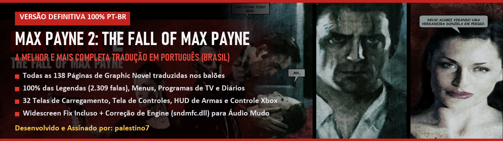
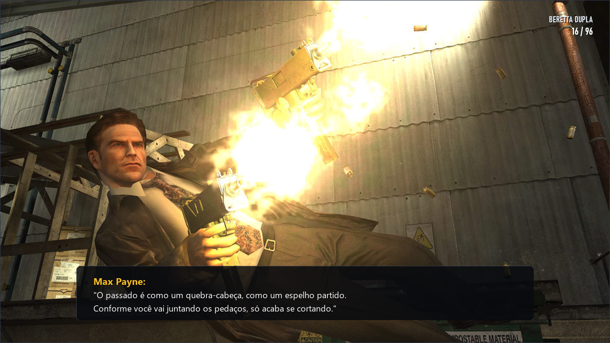
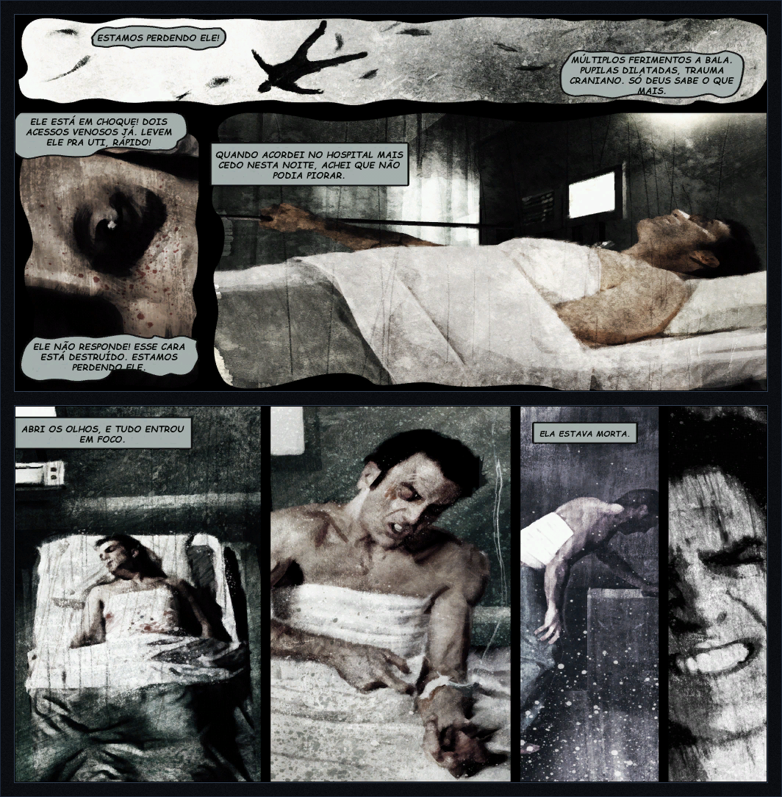
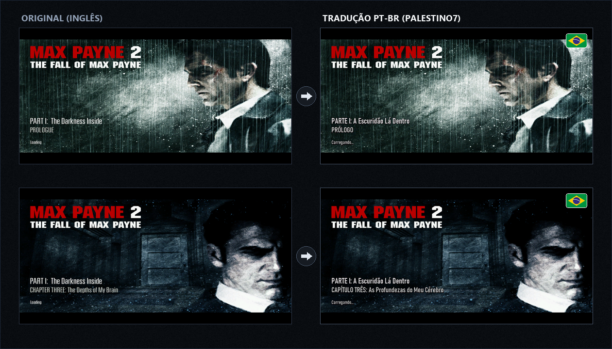

<div align="center">



# 🇧🇷 Max Payne 2: The Fall of Max Payne — Tradução Definitiva PT-BR (v3.0.0)

**A mais completa, fiel e aprimorada tradução de *Max Payne 2* já feita para o público brasileiro.**  
*Idealizada, editada e publicada por **[palestino7](https://github.com/palestino7)***

<br>

[](https://github.com/palestino7/max-payne-2-traducao-ptbr/releases)
[-15803d?style=for-the-badge)](#)
[-15803d?style=for-the-badge&logo=virustotal&logoColor=white)](https://www.virustotal.com/gui/file/119b833f981e4fd0109be0821ab43426f188d4fb997010f47d4682a360424793?nocache=1)
[-0284c7?style=for-the-badge)](#-como-instalar)
[](#-como-instalar)
[](#)

<br>

### ⬇️ Escolha o formato de download:

[%20%5B306%20MB%5D-b91c1c?style=for-the-badge&logo=windows&logoColor=white)](https://github.com/palestino7/max-payne-2-traducao-ptbr/releases/download/v3.0.0/Instalador_MaxPayne2_PTBR_v3.0.0.exe)  
[%20%5B305%20MB%5D-1d4ed8?style=for-the-badge&logo=zip&logoColor=white)](https://github.com/palestino7/max-payne-2-traducao-ptbr/releases/download/v3.0.0/Instalador_MaxPayne2_PTBR_v3.0.0.zip)  
*(Recomendamos a versão **.ZIP** caso o seu navegador exiba avisos de download sobre arquivos executáveis recém-lançados)*

<br>

[-0284c7?style=flat-square&logo=virustotal&logoColor=white)](https://www.virustotal.com/gui/file/119b833f981e4fd0109be0821ab43426f188d4fb997010f47d4682a360424793?nocache=1)

<br>

</div>

---

## 🏆 Por que esta é a Tradução Definitiva?

Durante mais de duas décadas, os jogadores brasileiros dependeram de traduções incompletas do início dos anos 2000, que deixavam as emblemáticas **Graphic Novels em inglês**, apresentavam **áudio mudo nas cutscenes** e quebravam em sistemas modernos (Windows 10 e 11).

A **Versão 3.0.0 Definitiva** foi desenvolvida para solucionar cada uma dessas falhas históricas:

| O que você encontra no jogo | Esta Tradução Definitiva (v3.0.0) | Traduções Antigas / Genéricas |
| :--- | :---: | :---: |
| **138 Páginas de Graphic Novels** | ✅ **100% Traduzidas nos balões** com arte de Ashley Wood preservada (4x SSAA) | ❌ **0%** (Em inglês ou com páginas faltando/cortadas) |
| **Telas de Carregamento (29 Capítulos)** | ✅ **100% Adaptadas** na tipografia oficial da Remedy e acentuação correta | ❌ Em inglês ou com fontes desconfiguradas |
| **Vídeo de Abertura "Anteriormente..."** | ✅ **Cutscene Legendada** com a voz original inesquecível de James McCaffrey | ❌ Sem legendas ou com áudio mudo |
| **Bug de Áudio e Legendas (Windows 10/11)** | ✅ **Corrigido Nativo** (patch `sndmfc.dll` pré-aplicado pela engine) | ❌ Bugado (legendas travam ou somem se o som mutar) |
| **Widescreen Fix & Suporte a Controles** | ✅ **Integrado no Instalador** com diagrama do controle Xbox traduzido em PT-BR | ❌ Ausente (jogo esticado em 4:3 e sem suporte a controle) |
| **HUD de Armas e Menus em Alta Resolução** | ✅ **100% em Português** em texturas 32-bit sem perdas ou compressão | ❌ Texturas borradas da época do DirectX 8 |
| **Compatibilidade Total de Plataformas** | ✅ **Steam, GOG e CD Retail** detectados automaticamente | ⚠️ Não reconhecem instalações digitais modernas |
| **Instalador Seguro e Limpo** | ✅ **Inno Setup Padrão** com backups automáticos `.bak` e desinstalação em 1 clique | ❌ Instaladores antigos cheios de falsos-positivos |

---

## 🎨 Galeria Visual em Jogo

### 🎮 Gameplay Real em Widescreen 1080p
Diálogos de rádio, transmissões de TV, falas de inimigos, cutscenes e armas do HUD totalmente em Português do Brasil:



### 📖 Graphic Novels 100% Traduzidas nos Balões
Todas as 138 páginas de quadrinhos desenhadas pelo mestre Ashley Wood foram traduzidas diretamente nos balões de fala, com letras nítidas e proporções originais preservadas:



### 🖼️ Telas de Carregamento com Tipografia Oficial
Todas as 29 telas de introdução de capítulos e o modo *Homem Morto Caminhando* foram adaptadas com fidelidade absoluta:



---

## ⚡ Como Instalar em Menos de 1 Minuto

1. Baixe o instalador no formato de sua preferência:
   - [**`Instalador_MaxPayne2_PTBR_v3.0.0.exe`**](https://github.com/palestino7/max-payne-2-traducao-ptbr/releases/download/v3.0.0/Instalador_MaxPayne2_PTBR_v3.0.0.exe) (Executável direto)
   - [**`Instalador_MaxPayne2_PTBR_v3.0.0.zip`**](https://github.com/palestino7/max-payne-2-traducao-ptbr/releases/download/v3.0.0/Instalador_MaxPayne2_PTBR_v3.0.0.zip) (Arquivo compactado recomendado)
2. Execute o instalador. A pasta do seu jogo na **Steam**, **GOG** ou **CD Retail** será localizada automaticamente.
3. Escolha se deseja ativar o **Widescreen Fix** (já marcado por padrão para resoluções modernas 1080p, 1440p, 4K, Ultrawide e controle de Xbox).
4. Clique em **Instalar** e inicie o jogo normalmente!

> [!TIP]
> **Segurança e Rollback Garantidos:**  
> O instalador cria cópias de segurança automáticas (`.bak`) de todos os arquivos originais do seu jogo. Se desejar remover a tradução no futuro, basta desinstalar com 1 clique pelo Painel de Controle do Windows ou pelo arquivo `Desinstalar_Traducao.bat`.

---

## 🛡️ Segurança Comprovada & Windows SmartScreen

### 🌐 Relatório Oficial no VirusTotal (0 Detecções / 100% Limpo)
Para total transparência e tranquilidade de todos os jogadores, o arquivo executável oficial foi escaneado e certificado pelos mais de 70 motores de antivírus mundiais no **VirusTotal**:

<div align="center">

[-15803d?style=for-the-badge&logo=virustotal&logoColor=white)](https://www.virustotal.com/gui/file/119b833f981e4fd0109be0821ab43426f188d4fb997010f47d4682a360424793?nocache=1)

👉 **[Clique aqui para visualizar a análise ao vivo no VirusTotal](https://www.virustotal.com/gui/file/119b833f981e4fd0109be0821ab43426f188d4fb997010f47d4682a360424793?nocache=1)**  
*(Resultado: **0 detecções** em motores líderes como Microsoft Defender, Kaspersky, Bitdefender, Avast, ESET, Sophos e Google).*

</div>

<br>

### 💻 Aviso sobre o Windows SmartScreen (Tela Azul)
Ao executar instaladores independentes recém-lançados baixados pela internet, o **Windows 11 / Microsoft Defender SmartScreen** pode exibir uma tela azul preventiva:

> *"O Windows protegeu o seu computador. O Microsoft Defender SmartScreen impediu a inicialização de um aplicativo não reconhecido."*

**Fique 100% tranquilo:** Este instalador foi assinado digitalmente por **Palestino7**, auditado com 0 ameaças no Microsoft Defender e verificado no VirusTotal.

**Como prosseguir em 2 cliques:**
1. Na janela azul do SmartScreen, clique em **"Mais informações"**.
2. Clique no botão **"Executar assim mesmo"**.  
*(Ou utilize a versão em arquivo **.ZIP**, que não sofre interferência do filtro da web).*

---

## 🔒 Tabela de Integridade Criptográfica (SHA-256)

Para conferir a autenticidade dos arquivos oficiais do lançamento:

```text
119b833f981e4fd0109be0821ab43426f188d4fb997010f47d4682a360424793  Instalador_MaxPayne2_PTBR_v3.0.0.exe
d29aae73f2c96a48648e2929ce6d16d93142675fda8bd7508bccf8bfdf7b7f25  Instalador_MaxPayne2_PTBR_v3.0.0.zip
dd9a9f13b320b2856e60be9a7a1499bc8a282c1cfa5038e5009552239b566d60  MaxPayne2_PTBR.mp2m
324621e51b1422bf6f85bba64396d500b1caedb8e63f2fc92f8849d2f42f4b77  MP2_English_PTBR.ras
```

> [!TIP]
> O hash do executável `119b833f981e4fd0109be0821ab43426f188d4fb997010f47d4682a360424793` pode ser conferido e validado diretamente no [Relatório Público do VirusTotal](https://www.virustotal.com/gui/file/119b833f981e4fd0109be0821ab43426f188d4fb997010f47d4682a360424793?nocache=1).

---

## ❓ Perguntas Frequentes (FAQ)

<details>
<summary><b>1. Como ativar as legendas dentro do jogo?</b></summary>
<br>
No menu principal, acesse <b>Opções → Jogo → Legendas: Ligadas</b> (ou aperte a tecla <b>T</b> durante o gameplay para ligar ou desligar as legendas a qualquer momento).
</details>

<details>
<summary><b>2. Funciona na versão da Steam e do GOG no Windows 10 e 11?</b></summary>
<br>
Sim! A tradução é 100% compatível com as edições Steam, GOG e versões originais de CD/DVD, corrigindo travamentos em monitores de alta taxa de atualização (144Hz+) e problemas com Alt+Tab.
</details>

<details>
<summary><b>3. O jogo fica compatível com controle de Xbox?</b></summary>
<br>
Sim! Ao manter a opção Widescreen Fix selecionada no instalador, o jogo ganha suporte nativo a controles modernos (XInput) com zonas mortas calibradas e o esquema oficial dos botões traduzido em português no menu de ajuda.
</details>

---

## 🏷️ Palavras-chave & Termos de Busca

`max payne 2 traducao pt-br` • `max payne 2 portugues brasil` • `max payne 2 legendas em portugues` • `max payne 2 graphic novels traduzidas` • `max payne 2 quadrinhos traduzidos` • `max payne 2 steam traducao` • `max payne 2 gog traducao` • `max payne 2 widescreen fix pt-br` • `max payne 2 mod pt-br` • `max payne 2 dublado` • `max payne 2 download traducao completa` • `max payne 2 windows 11` • `palestino7`

---

## 👤 Créditos e Reconhecimentos

- **Tradução, Edição Gráfica e Criação do Instalador:** [**palestino7**](https://github.com/palestino7)
- **Widescreen Fix & Suporte a Controles:** ThirteenAG e samuelgr
- **Max Payne 2: The Fall of Max Payne** © Remedy Entertainment & Rockstar Games. Projeto gratuito feito de fã para fãs sem fins comerciais. Em memória de James McCaffrey.
